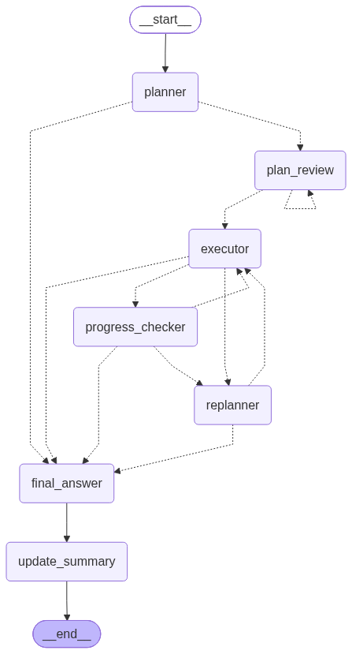
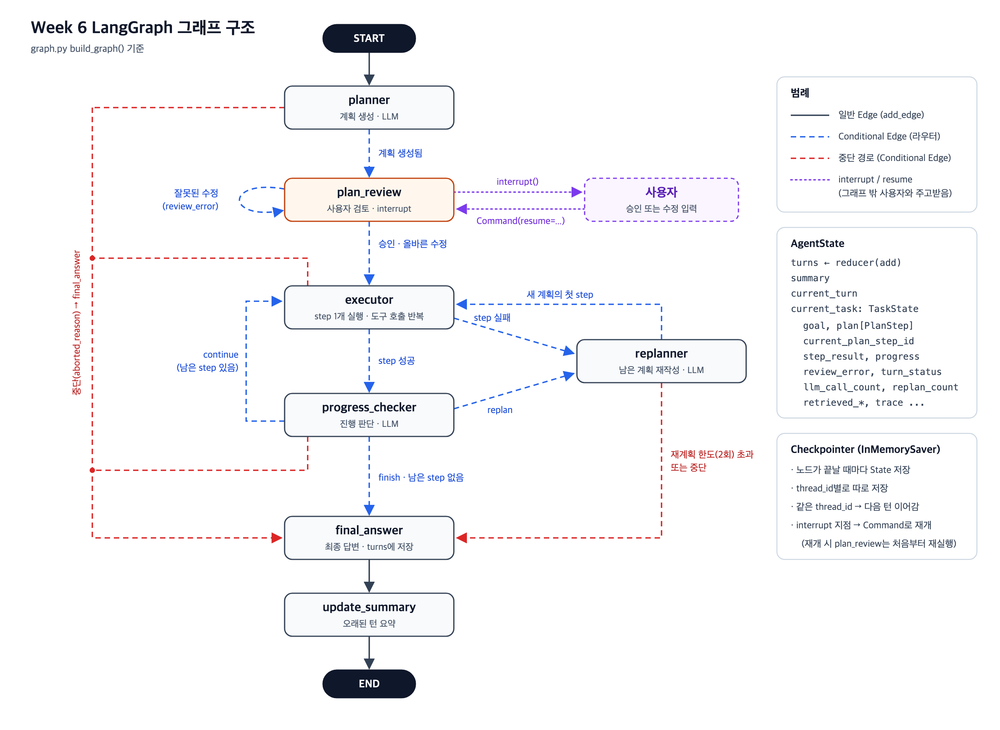

# Plan & Execute 에이전트의 LangGraph 전환 구현 설명서

이 문서는 Plan & Execute 에이전트를 LangGraph로 전환한 구현 내용을 설명합니다.

**핵심 변경사항**
- 기존 `run_turn()` 함수의 반복/분기 로직을 **Node와 Edge**로 재구성
- 계획 생성 후 **사용자 검토 단계** 추가 (인터럽트 기반)
- **Checkpointer와 `thread_id`**를 통한 대화 상태 관리

## 1. Plan Review 및 인터럽트 처리 방식

### 1.1 계획 확인 및 수정 방법

**동작 흐름**

1. 사용자 질문 입력 → `planner` Node가 실행 계획 생성
2. `plan_review` Node가 `interrupt()` 호출 → 그래프 실행 중단
3. 사용자에게 검토 요청 전달

**검토 요청 데이터 형식**

`start_turn()`의 반환값으로 다음 정보가 전달됩니다:

```python
{
    "goal": "사용자 질문",
    "plan": [{"id": 1, "instruction": "...", "depends_on": [], "status": "pending"}, ...],
    "error": None  # 직전 수정이 거부된 경우 사유
}
```

**사용자 응답 형식**

사용자는 `resume_turn()`을 통해 다음 두 가지 방식으로 응답할 수 있습니다:

| 구분 | 입력 형식 | 처리 내용 |
|---|---|---|
| **승인** | `{"action": "approve"}` | 생성된 계획을 그대로 실행 |
| **수정** | `{"action": "edit", "steps": [{"instruction": "...", "depends_on": [...]}, ...]}` | 단계 목록을 교체하여 실행 |

**계획 수정 시 검증 규칙**

수정된 계획은 `normalize_initial_plan()` 함수로 검증됩니다:

- ✅ 단계 개수: 1~8개
- ✅ `instruction`: 빈 문자열 불가
- ✅ `depends_on`: 자신보다 앞선 단계 번호만 참조 가능
- ✅ 단계 번호는 입력 순서대로 1부터 자동 부여
- ✅ `status`, `result` 등 내부 필드는 시스템이 초기화

검증 실패 또는 잘못된 `action` 값 입력 시:
- 계획 변경 없이 `review_error`에 사유 기록
- 동일한 계획으로 검토 재요청

### 1.2 인터럽트에 의한 중단과 재개 과정

**전체 실행 흐름**

```
1. start_turn() 호출
   ↓ current_turn, current_task 구성
2. planner 실행
   ↓ 계획 생성하여 plan에 저장
3. plan_review 실행
   ↓ interrupt() 호출
   ⏸️ 그래프 실행 중단
   ↓ Checkpointer가 State + 다음 Node를 thread_id별로 저장
4. 사용자 검토 입력
   ↓ resume_turn() 호출
5. plan_review 재실행
   ↓ interrupt()는 중단 없이 사용자 입력 반환
   ↓ 승인 → 계획 유지 / 수정 → plan 교체 / 오류 → review_error 기록
6. route_after_review() 분기
   ↓ review_error 있음 → plan_review 재요청
   ↓ review_error 없음 → executor로 진행
```

**재개 시 설계 고려사항**

재개 시 `plan_review` Node가 처음부터 다시 실행됩니다. 이를 고려한 설계:

**1. 계획 생성과 검토의 분리**
- ✅ LLM 호출은 `planner`에서만 수행
- ✅ `plan_review`는 LLM을 호출하지 않음
- 🔍 **이유**: 재개 시마다 계획이 재생성되면 사용자가 검토한 계획과 실제 실행 계획이 달라질 수 있음

**2. Interrupt 이전 코드의 멱등성**
- ✅ `interrupt()` 이전에는 State 읽기만 수행
- 🔍 **이유**: 여러 번 실행되어도 결과가 동일해야 함

**3. 지역 변수 미사용**
- ✅ 재개 후 필요한 모든 정보를 State에 저장
- 🔍 **이유**: 재개는 새로운 `invoke` 호출이므로 지역 변수가 유지되지 않음

**4. 중복 실행 방지**
- ✅ 검토 대기 중인 thread에 새 질문 입력 시 오류 처리
- 🔍 **이유**: LangGraph는 중단된 실행을 버리고 처음부터 재시작함

### 1.3 실행 결과

**테스트 질문**
> 2026년 해외 출장의 숙박비와 식비 한도, 출발 전 승인요건을 근거와 함께 정리해줘.

**테스트 구성**
- 테스트 1: 계획 승인 후 실행 (`thread_id = "test-approve"`)
- 테스트 2: 계획 수정 후 실행 (`thread_id = "test-edit"`)
- 두 테스트는 서로 다른 `thread_id`를 사용하여 대화 기록 분리

아래 결과는 `test_langgraph_agent.ipynb`에서 실행한 출력입니다.

#### (1) 계획 승인 후 실행 (`thread_id = "test-approve"`)

생성된 계획

```
[계획 검토 요청] 2026년 해외 출장의 숙박비와 식비 한도, 출발 전 승인요건을 근거와 함께 정리해줘.

1. 검색: 2026 년 해외 출장 관련 정책 문서에서 숙박비와 식비의 한도 기준을 찾아라.  (depends_on=[])
2. 검색: 2026 년 해외 출장 관련 정책 문서에서 출발 전 승인 요건과 근거를 찾아라.  (depends_on=[])
3. 추론: 검색된 숙박비/식비 한도 정보와 출발 전 승인 요건 정보를 종합하여 정리하라.  (depends_on=[1, 2])
```

사용자 입력

```
{
  "action": "approve"
}
```

재개 후 실행 결과

```
[completed / 4 LLM calls / 0 replans]

[Final Answer]

2026 년 해외 출장 관련 정책 정보를 근거와 함께 정리해 드립니다.

**1. 비용 한도 기준**
*   **숙박비**: 1 박당 **220 달러**까지 청구 가능합니다.
    *   근거: `travel_lodging_B.txt` (2026 년, active)
*   **식비**: 1 일당 **60 달러**까지 정산됩니다.
    *   근거: `meal_expense.txt` (2026 년, active)

**2. 출발 전 승인 요건**
*   국제 비즈니스 출장 요청은 **출발 전에 부서장 (Department Head) 의 승인**을 반드시 받아야 합니다.
    *   근거: `travel_request.txt` (2026 년, active)

상기 내용은 2026 년 기준 활성 (active) 상태의 내부 문서에서 확인된 내용입니다.
```

<details>
<summary>Trace</summary>

```
01. {"event": "turn_started", "goal": "2026년 해외 출장의 숙박비와 식비 한도, 출발 전 승인요건을 근거와 함께 정리해줘."}
02. {"event": "plan_created", "plan": [{"id": 1, "instruction": "검색: 2026 년 해외 출장 관련 정책 문서에서 숙박비와 식비의 한도 기준을 찾아라.", "depends_on": [], "status": "pending"}, {"id": 2, "instruction": "검색: 2026 년 해외 출장 관련 정책 문서에서 출발 전 승인 요건과 근거를 찾아라.", "depends_on": [], "status": "pending"}, {"id": 3, "instruction": "추론: 검색된 숙박비/식비 한도 정보와 출발 전 승인 요건 정보를 종합하여 정리하라.", "depends_on": [1, 2], "status": "pending"}]}
03. {"event": "plan_reviewed", "action": "approve"}
04. {"event": "plan_step_started", "plan_step_id": 1, "instruction": "검색: 2026 년 해외 출장 관련 정책 문서에서 숙박비와 식비의 한도 기준을 찾아라.", "depends_on": []}
05. {"event": "agent_loop_iteration", "plan_step_id": 1, "iteration": 1, "tool_call_count": 1}
06. {"event": "tool_called", "plan_step_id": 1, "tool": "search_documents", "arguments": {"query": "2026 년 해외 출장 관련 정책 문서에서 숙박비와 식비의 한도 기준", "status_filter": "active"}, "result_summary": {"status": "saved", "state_key": "current_task.retrieved_documents", "document_ids": ["travel_lodging_B", "meal_expense"]}}
07. {"event": "agent_loop_iteration", "plan_step_id": 1, "iteration": 2, "tool_call_count": 0}
08. {"event": "progress_checked", "plan_step_id": 1, "decision": "continue", "reason": "Step 1 successfully retrieved the necessary expense limits. The plan proceeds to Step 2 to find pre-departure approval requirements, which is a valid next step."}
09. {"event": "plan_step_started", "plan_step_id": 2, "instruction": "검색: 2026 년 해외 출장 관련 정책 문서에서 출발 전 승인 요건과 근거를 찾아라.", "depends_on": []}
10. {"event": "agent_loop_iteration", "plan_step_id": 2, "iteration": 1, "tool_call_count": 1}
11. {"event": "tool_called", "plan_step_id": 2, "tool": "search_documents", "arguments": {"query": "2026 년 해외 출장 관련 정책 문서에서 출발 전 승인 요건과 근거", "status_filter": "active"}, "result_summary": {"status": "saved", "state_key": "current_task.retrieved_documents", "document_ids": ["travel_request"]}}
12. {"event": "agent_loop_iteration", "plan_step_id": 2, "iteration": 2, "tool_call_count": 0}
13. {"event": "progress_checked", "plan_step_id": 2, "decision": "continue", "reason": "Step 2 successfully retrieved the pre-departure approval requirements and their basis. The next step (Step 3) depends on both Step 1 (accommodation/meal limits) and Step 2 (approval requirements). Since Step 2 is complete and the necessary information is available, the plan can proceed to Step 3 for synthesis."}
14. {"event": "plan_step_started", "plan_step_id": 3, "instruction": "추론: 검색된 숙박비/식비 한도 정보와 출발 전 승인 요건 정보를 종합하여 정리하라.", "depends_on": [1, 2]}
15. {"event": "agent_loop_iteration", "plan_step_id": 3, "iteration": 1, "tool_call_count": 1}
16. {"event": "tool_called", "plan_step_id": 3, "tool": "search_documents", "arguments": {"query": "2026 년 해외 출장 숙박비 식비 한도 및 출발 전 승인 요건", "status_filter": "active"}, "result_summary": {"status": "saved", "state_key": "current_task.retrieved_documents", "document_ids": ["travel_lodging_B", "meal_expense"]}}
17. {"event": "agent_loop_iteration", "plan_step_id": 3, "iteration": 2, "tool_call_count": 0}
18. {"event": "progress_checked", "plan_step_id": 3, "decision": "finish", "reason": "추론 단계가 완료되었으며, 남은 단계가 없습니다. 최종 답변을 작성할 수 있습니다."}
19. {"event": "turn_completed", "status": "completed"}
```

</details>

**결과 요약**
- ✅ 승인된 계획의 3단계가 순서대로 실행됨
- ✅ 최종 답변에 근거 문서 출처 포함 (`travel_lodging_B.txt`, `meal_expense.txt`, `travel_request.txt`)
- ✅ 총 4회 LLM 호출, 재계획 0회로 완료

#### (2) 계획 수정 후 실행 (`thread_id = "test-edit"`)

수정 전 계획

```
[계획 검토 요청] 2026년 해외 출장의 숙박비와 식비 한도, 출발 전 승인요건을 근거와 함께 정리해줘.

1. 검색: 2026 년 해외 출장 관련 정책 문서에서 숙박비와 식비의 한도 기준을 찾아라.  (depends_on=[])
2. 검색: 2026 년 해외 출장 관련 정책 문서에서 출발 전 승인 요건과 근거를 찾아라.  (depends_on=[])
3. 추론: 검색된 숙박비/식비 한도 정보와 출발 전 승인 요건 정보를 종합하여 정리하라.  (depends_on=[1, 2])
```

먼저 1단계가 뒤에 있는 2단계에 의존하도록 잘못 수정한 계획을 입력하였다.

사용자 입력 (잘못된 수정)

```
{
  "action": "edit",
  "steps": [
    {
      "instruction": "사내 문서에서 해외 출장 출발 전 승인 요건을 검색한다.",
      "depends_on": [
        2
      ]
    },
    {
      "instruction": "사내 문서에서 2026년 기준 해외 출장 숙박비 한도와 식비 한도를 검색한다.",
      "depends_on": []
    }
  ]
}
```

수정은 검증 단계에서 거부되었고, 기존 계획에 대해 검토가 다시 요청되었다.

```
[계획 검토 요청] 2026년 해외 출장의 숙박비와 식비 한도, 출발 전 승인요건을 근거와 함께 정리해줘.

! 이전 수정이 거부됨: Plan step 1 has invalid dependencies.

1. 검색: 2026 년 해외 출장 관련 정책 문서에서 숙박비와 식비의 한도 기준을 찾아라.  (depends_on=[])
2. 검색: 2026 년 해외 출장 관련 정책 문서에서 출발 전 승인 요건과 근거를 찾아라.  (depends_on=[])
3. 추론: 검색된 숙박비/식비 한도 정보와 출발 전 승인 요건 정보를 종합하여 정리하라.  (depends_on=[1, 2])
```

이어서 숙박비 한도, 식비 한도, 출발 전 승인 요건을 각각 검색하는 세 단계로 계획을 수정하였다.

사용자 입력 (올바른 수정)

```
{
  "action": "edit",
  "steps": [
    {
      "instruction": "사내 문서에서 2026년 기준 해외 출장 숙박비 한도를 검색한다. active 문서를 우선한다.",
      "depends_on": []
    },
    {
      "instruction": "사내 문서에서 2026년 기준 해외 출장 식비 한도를 검색한다. active 문서를 우선한다.",
      "depends_on": []
    },
    {
      "instruction": "사내 문서에서 해외 출장 출발 전 승인 요건을 검색한다.",
      "depends_on": []
    }
  ]
}
```

수정 후 계획

```
1. 사내 문서에서 2026년 기준 해외 출장 숙박비 한도를 검색한다. active 문서를 우선한다.  (depends_on=[])
2. 사내 문서에서 2026년 기준 해외 출장 식비 한도를 검색한다. active 문서를 우선한다.  (depends_on=[])
3. 사내 문서에서 해외 출장 출발 전 승인 요건을 검색한다.  (depends_on=[])
```

재개 후 실행 결과

```
[completed / 4 LLM calls / 0 replans]

[Final Answer]

2026 년 해외 출장 관련 비용 한도 및 승인 요건은 다음과 같습니다.

**1. 숙박비 한도**
*   **한도**:每晚 220 달러
*   **근거**: `travel_lodging_B.txt` (2026 년, active)
    *   "For international business trips, employees may claim accommodation expenses up to 220 dollars per night."

**2. 식비 한도**
*   **한도**: 하루 60 달러
*   **근거**: `meal_expense.txt` (2026 년, active)
    *   "Meal expenses on approved business trips are reimbursed up to 60 dollars per day."

**3. 출발 전 승인 요건**
*   **요건**: 부서장 (Department Head) 의 승인 필요
*   **근거**: `travel_request.txt` (2026 년, active)
    *   "International business travel requests must be approved by the department head before departure."
```

<details>
<summary>Trace</summary>

```
01. {"event": "turn_started", "goal": "2026년 해외 출장의 숙박비와 식비 한도, 출발 전 승인요건을 근거와 함께 정리해줘."}
02. {"event": "plan_created", "plan": [{"id": 1, "instruction": "검색: 2026 년 해외 출장 관련 정책 문서에서 숙박비와 식비의 한도 기준을 찾아라.", "depends_on": [], "status": "pending"}, {"id": 2, "instruction": "검색: 2026 년 해외 출장 관련 정책 문서에서 출발 전 승인 요건과 근거를 찾아라.", "depends_on": [], "status": "pending"}, {"id": 3, "instruction": "추론: 검색된 숙박비/식비 한도 정보와 출발 전 승인 요건 정보를 종합하여 정리하라.", "depends_on": [1, 2], "status": "pending"}]}
03. {"event": "plan_reviewed", "action": "edit", "plan": [{"id": 1, "instruction": "사내 문서에서 2026년 기준 해외 출장 숙박비 한도를 검색한다. active 문서를 우선한다.", "depends_on": [], "status": "pending"}, {"id": 2, "instruction": "사내 문서에서 2026년 기준 해외 출장 식비 한도를 검색한다. active 문서를 우선한다.", "depends_on": [], "status": "pending"}, {"id": 3, "instruction": "사내 문서에서 해외 출장 출발 전 승인 요건을 검색한다.", "depends_on": [], "status": "pending"}]}
04. {"event": "plan_step_started", "plan_step_id": 1, "instruction": "사내 문서에서 2026년 기준 해외 출장 숙박비 한도를 검색한다. active 문서를 우선한다.", "depends_on": []}
05. {"event": "agent_loop_iteration", "plan_step_id": 1, "iteration": 1, "tool_call_count": 1}
06. {"event": "tool_called", "plan_step_id": 1, "tool": "search_documents", "arguments": {"query": "2026 년 해외 출장 숙박비 한도", "status_filter": "active"}, "result_summary": {"status": "saved", "state_key": "current_task.retrieved_documents", "document_ids": ["travel_lodging_B"]}}
07. {"event": "agent_loop_iteration", "plan_step_id": 1, "iteration": 2, "tool_call_count": 0}
08. {"event": "progress_checked", "plan_step_id": 1, "decision": "continue", "reason": "The current step successfully retrieved the 2026 international travel accommodation limit from an active document. The remaining steps are still valid and can proceed."}
09. {"event": "plan_step_started", "plan_step_id": 2, "instruction": "사내 문서에서 2026년 기준 해외 출장 식비 한도를 검색한다. active 문서를 우선한다.", "depends_on": []}
10. {"event": "agent_loop_iteration", "plan_step_id": 2, "iteration": 1, "tool_call_count": 1}
11. {"event": "tool_called", "plan_step_id": 2, "tool": "search_documents", "arguments": {"query": "2026 년 해외 출장 식비 한도", "status_filter": "active"}, "result_summary": {"status": "saved", "state_key": "current_task.retrieved_documents", "document_ids": ["travel_lodging_B", "meal_expense"]}}
12. {"event": "agent_loop_iteration", "plan_step_id": 2, "iteration": 2, "tool_call_count": 0}
13. {"event": "progress_checked", "plan_step_id": 2, "decision": "continue", "reason": "The current step successfully retrieved the 2026 overseas business trip meal expense limit from active documents. The next step is to search for pre-departure approval requirements, which is a valid continuation of the plan."}
14. {"event": "plan_step_started", "plan_step_id": 3, "instruction": "사내 문서에서 해외 출장 출발 전 승인 요건을 검색한다.", "depends_on": []}
15. {"event": "agent_loop_iteration", "plan_step_id": 3, "iteration": 1, "tool_call_count": 1}
16. {"event": "tool_called", "plan_step_id": 3, "tool": "search_documents", "arguments": {"query": "해외 출장 출발 전 승인 요건", "status_filter": "active"}, "result_summary": {"status": "saved", "state_key": "current_task.retrieved_documents", "document_ids": ["travel_request"]}}
17. {"event": "agent_loop_iteration", "plan_step_id": 3, "iteration": 2, "tool_call_count": 0}
18. {"event": "progress_checked", "plan_step_id": 3, "decision": "finish", "reason": "The current step has been completed successfully, and there are no remaining steps in the plan. The required information regarding pre-departure approval requirements for overseas business travel has been retrieved and confirmed."}
19. {"event": "turn_completed", "status": "completed"}
```

</details>

**결과 요약**
- ✅ 잘못된 수정 (의존성 오류) → 검증 실패로 거부됨
- ✅ 올바른 수정 (3개 독립 단계) → 검증 통과 후 실행됨
- ✅ Trace의 `plan_reviewed` 이벤트에 수정된 계획 기록
- ✅ 수정된 3단계가 순서대로 실행됨
- ✅ 최종 답변에 근거 문서와 원문 인용 포함

> **참고**: 숙박비 항목의 "每晚"는 "1박당"을 뜻하는 중국어로, LLM 출력을 그대로 표시한 것입니다.

## 2. Node와 노드 그래프

### 2.1 Node 구성

그래프는 **7개의 Node**로 구성되며, 모든 Node는 `nodes.py`에 정의되어 있습니다.

| Node | 주요 역할 | 세부 동작 |
|---|---|---|
| **`planner`** | 📋 실행 계획 생성 | 대화 요약 + 최근 대화 + 현재 질문을 바탕으로 계획 작성 |
| **`plan_review`** | ⏸️ 계획 검토 (인터럽트) | 계획을 사용자에게 제시하고 중단. 재개 시 승인/수정 반영 |
| **`executor`** | 🔧 단계 실행 | 현재 단계를 실행 (LLM + Tool 호출 최대 6회 반복) |
| **`progress_checker`** | 🔍 진행 상태 평가 | 실행 결과 평가 후 continue/replan/finish 결정 |
| **`replanner`** | 🔄 계획 재작성 | 실패/부족한 단계를 새 단계로 대체 (최대 2회, 초과 시 실패) |
| **`final_answer`** | ✅ 최종 답변 생성 | 완료된 단계 결과 + 근거 문서로 답변 작성 및 대화 기록 추가 |
| **`update_summary`** | 📝 대화 요약 | 최근 2턴보다 오래된 대화 요약하여 저장 |

### 2.2 Node 연결과 조건부 분기

Node 연결은 `graph.py`의 `build_graph()`에서 정의됩니다.

**일반 Edge (고정 순서)**
- `START` → `planner`
- `final_answer` → `update_summary` → `END`

**Conditional Edge (State 기반 분기)**

State 값에 따라 다음 Node가 동적으로 결정됩니다. 라우터 함수는 State를 읽기만 하고 변경하지 않습니다.

| 출발 | 라우터 함수 | 조건 (State 필드) | 다음 Node |
|---|---|---|---|
| **`planner`** | `route_after_planner` | `aborted_reason` 존재 (오류 발생) | `final_answer` |
| | | 정상 | `plan_review` |
| **`plan_review`** | `route_after_review` | `review_error` 존재 (수정 거부) | `plan_review` (재요청) |
| | | 승인/정상 수정 | `executor` |
| **`executor`** | `route_after_executor` | `aborted_reason` 존재 | `final_answer` |
| | | `step_result.status == "failed"` | `replanner` |
| | | 단계 실행 성공 | `progress_checker` |
| **`progress_checker`** | `route_after_progress` | `aborted_reason` 존재 | `final_answer` |
| | | `decision == "replan"` | `replanner` |
| | | `decision == "finish"` 또는 `current_plan_step_id == None` | `final_answer` |
| | | `decision == "continue"` | `executor` |
| **`replanner`** | `route_after_replanner` | `turn_status == "failed"` (한도 초과 등) | `final_answer` |
| | | 정상 | `executor` |

**핵심 구조**
- 🔄 **단계 반복**: `executor` ↔ `progress_checker` 순환
- 🔄 **재계획**: 실패/부족 시 `replanner` 경유
- ⚠️ **오류 처리**: 어느 지점에서든 `aborted_reason` 발생 시 `final_answer`로 이동

### 2.3 노드 그래프

아래 그래프는 LangGraph의 `app.get_graph().draw_mermaid_png()`로 생성된 것입니다.
- **실선**: 일반 Edge (고정 순서)
- **점선**: Conditional Edge (조건부 분기)



**그림 1.** LangGraph가 생성한 노드 그래프



**그림 2.** 분기 조건과 인터럽트를 표시한 노드 그래프

## 3. State 설명

### 3.1 State 필드

State는 `state.py`에 정의되어 있으며 **3단계 구조**로 구성됩니다:

```
AgentState (그래프 전체)
├── turns, summary, current_turn (대화 정보)
└── current_task: TaskState (현재 턴 작업)
    └── plan: list[PlanStep] (실행 계획 단계들)
```

**구조 설명**
- **`AgentState`**: 여러 턴에 걸쳐 유지되는 대화 정보 + 현재 턴 정보
- **`TaskState`**: 한 턴의 작업 상태 (계획, 진행 상황, 검색 결과 등)
- **`PlanStep`**: 계획의 각 단계 정보

> **참고**: 표에서 `Message`는 OpenAI chat 형식 (`role`, `content` 등을 가진 dict)

#### AgentState (그래프 전체 상태)

| 필드 | 자료형 | 역할 | 갱신 방식 |
|---|---|---|---|
| **`turns`** | `list[list[Message]]` | 완료된 턴들의 대화 기록 | `operator.add`로 누적 (final_answer) |
| **`summary`** | `str` | 오래된 턴의 요약 | 덮어쓰기 (update_summary) |
| **`current_turn`** | `list[Message]` | 진행 중인 턴의 메시지 | 덮어쓰기 (final_answer) |
| **`current_task`** | `TaskState \| None` | 진행 중인 턴의 작업 상태 | 덮어쓰기 (모든 Node) |

> **초기값**: `current_turn`과 `current_task`는 `start_turn()`이 그래프 입력으로 전달

#### TaskState (턴 작업 상태)

**핵심 필드**

| 필드 | 자료형 | 역할 | 설명 |
|---|---|---|---|
| **`goal`** | `str` | 사용자 질문 | 턴 시작 시 입력, 이후 변경 없음 |
| **`plan`** | `list[PlanStep]` | 실행 계획 | planner/plan_review에서 생성/수정 |
| **`current_plan_step_id`** | `int \| None` | 다음 실행 단계 번호 | `None`이면 남은 단계 없음 |
| **`retrieved_documents`** | `dict[str, dict]` | 검색된 문서 저장소 | executor가 검색 결과 저장 |
| **`retrieved_memories`** | `dict[str, dict]` | 검색된 메모리 저장소 | executor가 메모리 검색 결과 저장 |

**제어 및 상태 필드**

| 필드 | 자료형 | 역할 |
|---|---|---|
| `plan_revision` | `int` | 재계획으로 계획이 바뀐 횟수 (기록용) |
| `replan_count` | `int` | 이번 턴의 재계획 횟수 (최대 2회) |
| `llm_call_count` | `int` | 이번 턴의 LLM 호출 수 (최대 30회, planner/progress_checker/replanner만 카운트) |
| `aborted_reason` | `str \| None` | 턴 중단 사유 (오류 발생 시) |
| `turn_status` | `"completed" \| "failed"` | 턴 실행 결과 |
| `trace` | `list[dict]` | 실행 기록 (결과 출력용) |

**Node 간 전달 필드**

| 필드 | 자료형 | 역할 |
|---|---|---|
| `step_result` | `StepResult \| None` | executor → progress_checker로 단계 실행 결과 전달 |
| `progress` | `ProgressResult \| None` | progress_checker → replanner로 진행 판단 결과 전달 |
| `review_error` | `str \| None` | 계획 수정 거부 사유 (검증 실패 시) |

#### PlanStep (계획 단계)

| 필드 | 자료형 | 역할 | 설정 시점 |
|---|---|---|---|
| **`id`** | `int` | 단계 번호 | planner/plan_review/replanner에서 생성/수정 시 |
| **`instruction`** | `str` | 수행할 작업 | planner/plan_review/replanner에서 생성/수정 시 |
| **`depends_on`** | `list[int]` | 참고할 앞선 단계 번호 | planner/plan_review/replanner에서 생성/수정 시 |
| **`status`** | `str` | 단계 상태 | 실행 중 동적 변경 (아래 참고) |
| **`result`** | `str \| None` | 단계 실행 결과 | executor에서 설정 |
| `messages` | `list[Message]` | LLM·Tool 호출 기록 | executor 내부에서 누적 |
| `document_ids` | `list[str]` | 찾은 문서 ID (기록용) | executor에서 설정 |
| `memory_ids` | `list[str]` | 찾은 메모리 ID (기록용) | executor에서 설정 |

**`status` 변경 흐름**

```
pending (초기)
  ↓ executor 시작
in_progress (실행 중)
  ↓ progress_checker 완료 판단
completed (완료)
```

또는:
```
pending/in_progress
  ↓ replanner에서 대체
replaced (재계획으로 대체됨)
```

또는:
```
pending/in_progress
  ↓ 재계획 한도 초과
failed (실패 처리)
```

### 3.2 중단·재개 시 보존해야 하는 정보

**중단 시 저장되는 정보**

`plan_review`에서 `interrupt()` 호출 시 Checkpointer가 `thread_id` 단위로 저장:
- ✅ State 전체 (모든 필드)
- ✅ 다음 실행할 Node 정보

> **중요**: 재개는 새로운 `invoke` 호출이므로 **지역 변수는 유지되지 않음**

**재개 후 필요한 정보 (State에 저장됨)**

| 카테고리 | 필드 | 용도 |
|---|---|---|
| **계획 정보** | `goal`, `plan`, `current_plan_step_id` | 검토 대상 및 실행 진행 상태 |
| **검증 정보** | `review_error` | 직전 수정의 거부 사유 |
| **리소스 제한** | `llm_call_count` | 턴 단위 LLM 호출 한도 (planner 포함) |
| **대화 정보** | `current_turn`, `turns`, `summary` | 대화 맥락 유지 |
| **실행 상태** | `step_result`, `progress`, `turn_status` | Node 간 전달 정보 |
| **기록** | `trace` | 실행 과정 추적 |

**State에 저장되지 않는 정보**

LLM 클라이언트와 모델 이름은 runtime context(`AgentContext`)로 전달되므로:
- ❌ Checkpointer에 저장되지 않음
- ✅ `resume_turn()` 호출 시 동일한 context 재전달 필요

**대화 이어가기**

같은 `thread_id`로 새 질문 입력 시:
- ✅ `current_turn`, `current_task`만 새로 입력
- ✅ `turns`, `summary`는 기존 값 유지 → 이전 대화 맥락 유지

### 3.3 State 갱신 방식

**기본 원칙**

Node는 State를 직접 수정하지 않고 변경할 필드만 반환합니다:

```python
# Node 함수 예시
def some_node(state: AgentState) -> dict:
    # State를 직접 수정하지 않음
    return {"변경할_필드": 새_값}  # 변경할 필드만 반환
```

**갱신 방식**

| 방식 | 대상 필드 | 동작 |
|---|---|---|
| **덮어쓰기 (기본)** | 대부분의 필드 | 반환된 값이 기존 값을 대체 |
| **누적 (reducer)** | `turns` | `operator.add`로 기존 리스트에 추가 |

**예시**
```python
# final_answer에서 turns 추가
return {"turns": [이번_턴]}  # 기존 turns 뒤에 추가됨
```

**Nested Dictionary 갱신**

`current_task`는 nested dictionary이므로 기존 필드를 함께 반환해야 합니다:

```python
# 올바른 방법
return {"current_task": {**task, "plan": 새_계획}}

# 잘못된 방법
return {"current_task": {"plan": 새_계획}}  # 다른 필드 소실!
```

리스트(`trace`, `plan` 등)도 기존 값을 수정하지 않고 새 리스트를 생성하여 반환합니다.

**Tool 실행 시 특별 처리**

Tool 함수는 State를 직접 수정하도록 작성되어 있습니다. 이에 대한 처리:

```python
# executor에서의 처리
작업용_state = copy.deepcopy({
    "plan": state["current_task"]["plan"],
    "retrieved_documents": state["current_task"]["retrieved_documents"],
    "retrieved_memories": state["current_task"]["retrieved_memories"],
    "trace": state["current_task"]["trace"]
})

tool_함수(작업용_state)  # Tool이 작업용 State를 수정

return {"current_task": {**task, **작업용_state}}  # 수정된 결과 반환
```

## 실행 환경 및 실행 순서

### 실행 환경

**시스템 요구사항**
- Python 3.11.13
- 필요한 패키지: `requirements.txt` 참조

**사용 모델**
- **LLM**: OpenAI 호환 API 서버 (`https://agent.kau.ac.kr/v1`)
- **임베딩**: `Qwen/Qwen3-Embedding-0.6B`
  - 첫 실행 시 Hugging Face에서 자동 다운로드

### 환경변수 설정

`term_project` 폴더에 `.env` 파일을 생성하고 아래 변수를 설정하세요:

| 변수명 | 필수 | 설명 | 기본값 |
|---|:---:|---|---|
| **`KAU_API_KEY`** | ✅ | LLM 서버 API 키 | - |
| `OPENAI_BASE_URL` | | LLM 서버 주소 | `https://agent.kau.ac.kr/v1` |
| `MODEL_NAME` | | 사용할 모델 이름 | 서버 목록의 첫 번째 모델 |
| `MEMORY_FILE` | | 장기 메모리 저장 파일 경로 | `memory_store.json` |

> **참고**: `.env` 파일은 보안상 제출하지 않았습니다.

### 실행 순서

**1. Python 환경 설정**
```bash
conda create -n llm python=3.11
conda activate llm
pip install -r requirements.txt
```

**2. 환경변수 설정**
`term_project` 폴더에 `.env` 파일 생성 후 `KAU_API_KEY` 입력

**3. 노트북 실행**
- `test_langgraph_agent.ipynb` 열기
- 커널: 위에서 생성한 `llm` 환경 선택
- 커널 재시작 후 모든 셀 순서대로 실행

**4. 실행 확인**
- 각 셀의 출력이 정상적으로 표시되는지 확인
- 계획 검토 요청 및 최종 답변 확인
