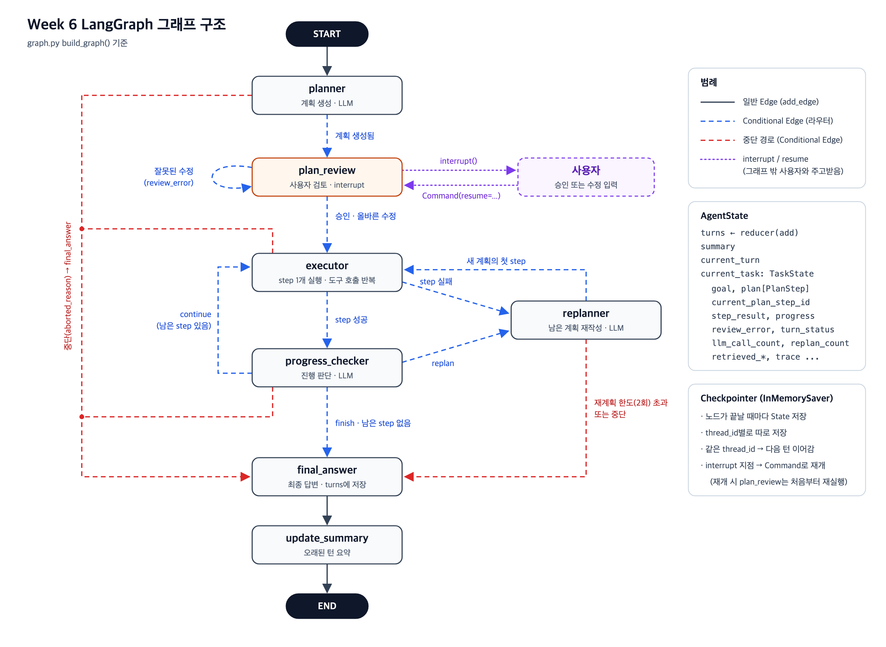

# 요구사항별 구현 위치

강의자료의 전환 요구사항 (1)~(7)이 코드의 어디에서 구현되는지 정리한 문서입니다. 링크는 이 문서(`docs/`) 기준 상대 경로입니다.

파일 구성
- [state.py](../state.py): State 타입 정의, State 생성 함수, 계획 검증
- [nodes.py](../nodes.py): 노드 7개와 라우터 5개
- [graph.py](../graph.py): 그래프 연결, checkpointer, 턴 시작/재개 함수
- [llm.py](../llm.py): LLM 호출 함수와 턴당 호출 예산
- [contexts.py](../contexts.py), [tools.py](../tools.py): 원본과 같은 파일 (노드별 context 생성, 도구)

---

## (1) 기존 Agent의 기능 유지

> 대화 기록, 요약, 계획, Tool 실행, 진행 판단, 재계획 기능을 유지한다.

- **대화 기록**: [final_answer](../nodes.py#L511) 노드가 이번 턴을 `turns`로 반환하면, [AgentState.turns](../state.py#L77)의 reducer가 기존 기록 뒤에 붙인다. 턴 사이에는 checkpointer가 보관한다.
- **요약**: [update_summary](../nodes.py#L548) 노드. `final_answer → update_summary` edge([graph.py:91](../graph.py#L91))로 매 턴 끝에 실행된다.
- **계획**: [planner](../nodes.py#L98) 노드. 계획 검증은 [normalize_initial_plan](../state.py#L198).
- **Tool 실행**: [executor](../nodes.py#L300) 노드가 [execute_plan_step](../nodes.py#L209)을 부르고, 그 안에서 도구 호출을 반복한다(최대 [6회](../nodes.py#L61)). 도구는 원본 [tools.py](../tools.py)를 그대로 쓴다.
- **진행 판단**: [progress_checker](../nodes.py#L363) 노드.
- **재계획**: [replanner](../nodes.py#L430) 노드. 턴당 최대 [2회](../nodes.py#L60).
- **턴당 LLM 호출 예산**(원본과 동일, 30회): [LLMCallBudget](../llm.py#L27), [call_json](../llm.py#L50).

## (2) State 명확히 정의

> PlanStep, TaskState, AgentState를 정의한다. 중단·재개 후에도 필요한 실행 정보는 State에 저장한다. 기존 turns와 current_turn 구조를 유지한다.

- **타입 정의**: [PlanStep](../state.py#L28), [TaskState](../state.py#L53), [AgentState](../state.py#L75)
- **중단·재개 후에도 필요한 실행 정보**: TaskState에 있다.
  - 원본 TaskState 항목: goal, plan, current_plan_step_id, llm_call_count, replan_count, trace 등
  - 원본에서 run_turn의 지역 변수였다가 State로 옮긴 항목: [turn_status, step_result, progress, review_error](../state.py#L68-L72)
- **turns와 current_turn**: [turns](../state.py#L77), [current_turn](../state.py#L79)
- **State 생성**: [create_state](../state.py#L87), [create_task_state](../state.py#L101). 새 턴의 입력은 [start_turn](../graph.py#L111)이 만든다.

## (3) Node와 Edge로 실행 흐름 구성

> 계획 생성, 실행, 진행 판단, 재계획, 최종 응답을 Node로 구분한다. 기존 실행 제어를 일반 Edge와 Conditional Edge로 옮긴다.

- **Node 등록**: [graph.py:63-69](../graph.py#L63-L69)
  - 계획 생성 [planner](../nodes.py#L98) · 실행 [executor](../nodes.py#L300) · 진행 판단 [progress_checker](../nodes.py#L363) · 재계획 [replanner](../nodes.py#L430) · 최종 응답 [final_answer](../nodes.py#L511)
  - 그 밖에 검토 [plan_review](../nodes.py#L139)(요구사항 7), 요약 [update_summary](../nodes.py#L548)
- **일반 Edge**: `START → planner`, `final_answer → update_summary`, `update_summary → END` ([graph.py:71](../graph.py#L71), [91-92](../graph.py#L91-L92))
- **Conditional Edge**: [graph.py:72-90](../graph.py#L72-L90). 분기 조건은 라우터 5개가 정한다.
  - [route_after_planner](../nodes.py#L577): 중단 → final_answer, 그 외 → plan_review
  - [route_after_review](../nodes.py#L583): 잘못된 수정 → plan_review, 그 외 → executor
  - [route_after_executor](../nodes.py#L589): 중단 → final_answer, step 실패 → replanner, 성공 → progress_checker
  - [route_after_progress](../nodes.py#L598): 중단 → final_answer, replan → replanner, 남은 step 없음 → final_answer, continue → executor
  - [route_after_replanner](../nodes.py#L609): 중단·한도 초과 → final_answer, 그 외 → executor
- **원본 실행 제어와의 대응**: 원본 run_turn의 while 반복은 `progress_checker → executor` 사이클로, if/continue/break는 위 Conditional Edge로 옮겼다.
- **참고**: 재계획 한도(2회) 검사는 라우터가 아니라 [replanner 노드 안](../nodes.py#L448)에서 한다. 한도를 넘으면 replanner가 실패 처리만 하고, route_after_replanner가 final_answer로 보낸다.

## (4) State 갱신 규칙 준수

> Node는 입력 State를 직접 수정하지 않고 변경할 항목만 반환한다. 기본 overwrite를 사용하고, 누적·병합이 필요한 경우에만 reducer를 적용한다. nested dictionary를 수정할 때는 보존할 기존 항목도 함께 반환한다.

- **변경할 항목만 반환**: 노드별 반환 키
  - planner, plan_review, executor, progress_checker, replanner: `current_task`
  - final_answer: `current_turn`, `turns`, `current_task`
  - update_summary: `summary` (요약할 턴이 없으면 `{}`)
- **입력 State를 직접 수정하지 않음**: 바꿀 값은 새 객체로 만든다.
  - [update_plan_step](../state.py#L169): 바뀐 step만 새로 만든 새 plan 리스트를 반환한다.
  - [trace_event](../state.py#L145): 노드가 `[*task["trace"], trace_event(...)]`로 새 trace 리스트를 만든다.
  - executor는 원본 tools.py가 넘겨받은 state를 직접 고치므로, [작업용 사본](../nodes.py#L311-L318)을 만들어 넘긴다.
- **overwrite와 reducer**: reducer는 [turns](../state.py#L77)에만 적용했다(`operator.add`, 대화 기록 누적). `summary`, `current_turn`, `current_task`는 overwrite다.
- **nested dictionary**: `current_task`를 반환하는 모든 노드가 `{**task, 바뀐 필드...}` 형태로 기존 필드를 함께 반환한다.

## (5) Node별 LLM Context 구분

> Graph State 전체를 LLM에 전달하지 않는다. 각 Node의 역할에 필요한 정보만 context에 포함한다.

LLM을 부르는 노드는 State 전체가 아니라 아래 함수가 만든 메시지만 LLM에 보낸다. plan_review는 LLM을 부르지 않는다.

- planner → [build_planner_context](../contexts.py#L121): 요약, 최근 2턴, 이번 질문
- executor → [build_executor_context](../contexts.py#L176): 현재 step, 의존 step의 결과, 그 step들이 찾은 문서·메모리, 이 step의 도구 호출 기록
- progress_checker → [build_progress_context](../contexts.py#L250): 현재 step, 실행 결과, 관련 문서, 남은 step
- replanner → [build_replanner_context](../contexts.py#L306): 원래 목표, 완료 step 결과, 실패 step과 사유, 그 step이 본 문서, 남아 있던 계획
- final_answer → [build_final_context](../contexts.py#L380): 완료 step 결과와 문서, 실패·중단 사유, 요약, 최근 2턴, 이번 질문
- update_summary → [build_summary_context](../contexts.py#L474): 최근 2턴보다 오래된 턴의 대화 텍스트

## (6) Checkpoint와 재개 구현

> Checkpointer와 thread_id를 사용하여 실행 상태를 저장한다. 동일한 대화의 연속 실행과 중단 후 재개가 가능해야 한다.

- **Checkpointer**: [build_graph](../graph.py#L60)가 `InMemorySaver`를 붙여 compile한다([graph.py:97](../graph.py#L97)). 노드가 끝날 때마다 State를 저장한다.
- **thread_id**: [make_config](../graph.py#L104)가 `{"configurable": {"thread_id": ...}}`를 만든다.
- **같은 대화 연속 실행**: [start_turn](../graph.py#L111)은 `current_turn`과 `current_task`만 입력으로 넣으므로, 같은 thread_id의 `turns`와 `summary`가 이어진다. thread의 첫 턴일 때만 `create_state()`로 초기화한다. 검토 대기 중인 thread에 새 질문을 넣으면 오류를 낸다.
- **중단 후 재개**: [resume_turn](../graph.py#L146)이 같은 thread_id로 `Command(resume=...)`를 보낸다. [get_outcome](../graph.py#L166)은 저장된 State를 보고 검토 대기인지 완료인지 판단한다.

## (7) 계획 승인·수정 구현

> 계획 생성과 사용자 검토를 별도 Node로 분리한다. interrupt()로 검토를 요청하고 Command(resume=...)로 결과를 받는다. 승인 또는 수정된 계획으로 실행되는지 확인한다. 재개 시 검토 Node가 처음부터 다시 실행된다는 점을 고려한다.

- **별도 Node**: 계획 생성 [planner](../nodes.py#L98), 사용자 검토 [plan_review](../nodes.py#L139)
- **interrupt()로 검토 요청**: [nodes.py:157](../nodes.py#L157). goal, plan, error를 넘기고 멈춘다.
- **Command(resume=...)로 결과 받기**: [resume_turn](../graph.py#L146). 입력 형식은 승인 `{"action": "approve"}`, 수정 `{"action": "edit", "steps": [{"instruction": ..., "depends_on": [...]}]}`
- **승인·수정 반영**: [nodes.py:168-202](../nodes.py#L168-L202). 승인은 계획을 그대로 두고, 수정은 [normalize_initial_plan](../state.py#L198)로 검증한 뒤 `plan`과 `current_plan_step_id`를 바꾼다. 잘못된 수정은 `review_error`를 남기고 [route_after_review](../nodes.py#L583)가 plan_review로 다시 보낸다.
- **재실행 고려**: [nodes.py:145-148](../nodes.py#L145-L148)
  - 계획 생성 LLM 호출은 planner에 두어, 검토 노드가 다시 실행되어도 LLM을 다시 부르지 않는다.
  - interrupt() 앞에는 State를 읽는 코드만 둔다.
- **확인**: [test_langgraph_agent.ipynb](../test_langgraph_agent.ipynb)의 테스트 1(승인)과 테스트 2(잘못된 수정 → 올바른 수정).
